# Linux Network Services & Security Administration Lab

**Rocky Linux · Ubuntu · Apache HTTP Server · NFS · OpenSSL · Fail2Ban · rsyslog**

> A collaborative System and Network Administration project demonstrating Linux network configuration, shared storage, web hosting, certificate management, SSH intrusion prevention, and centralized logging in a controlled academic lab.

## Project overview

Our five-person team designed, configured, and validated several interconnected Linux services. Rocky Linux acted as the main server environment and Ubuntu as a client. The project combined infrastructure administration with practical security monitoring and verification.

**Module:** CT106-3-2-SNA — System and Network Administration  
**University:** Asia Pacific University of Technology & Innovation  
**Project type:** Group assignment (five contributors; 20% each according to the submitted workload matrix)

## My contribution — Fairouz Abdulrahman Hamed Mousa

The submitted workload matrix (report pages 72–73) records my participation in the **shared configuration** of FQDN hostnames, static IP networking, NFS, Apache, the Certificate Authority, Fail2Ban, and rsyslog. It separately assigns me responsibility for **Apache Web Server documentation** and **Certificate Authority documentation**. This portfolio highlights those areas without presenting the team's work as a solo project.

## Lab architecture

```text
             Ubuntu client
     (browser, NFS mount, SSH, logs)
                   |
          Virtual lab network
                   |
             Rocky Linux
    +--------------+--------------+
    | NFS shares   | Apache vhosts|
    | OpenSSL CA   | Fail2Ban     |
    | rsyslog      | NetworkManager|
    +-----------------------------+
```

The report documents server and client configurations across several lab network settings. Addresses and domain names shown below are **lab examples** and should not be assumed to describe one persistent production deployment.

## Technologies and demonstrated tasks

| Area | Implementation and verification |
| --- | --- |
| Linux networking | FQDN hostnames and `/etc/hosts` mapping; static IPv4 configuration using NetworkManager and `nmcli` |
| Network File System | Exported `/var/nfs/general` from Rocky Linux; mounted on Ubuntu; tested file visibility in both directions; configured `/etc/fstab` for persistence |
| Apache HTTP Server | Installed and enabled `httpd`; created two document roots and virtual hosts; tested website access from Ubuntu |
| Certificates | Used OpenSSL to create keys and self-signed certificate material for the lab web service |
| SSH protection | Configured Fail2Ban and demonstrated temporary banning following repeated failed SSH logins |
| Centralized logging | Configured rsyslog forwarding/collection and tested log transmission between systems |

## 1. Network configuration

The server hostname and hosts mapping were configured using an FQDN. The Rocky Linux network interface was configured with a static IPv4 address using NetworkManager; the report uses `192.168.10.5` for this example.

```bash
hostnamectl
ip addr
nmcli general status
nmcli connection show
sudo systemctl status NetworkManager
```

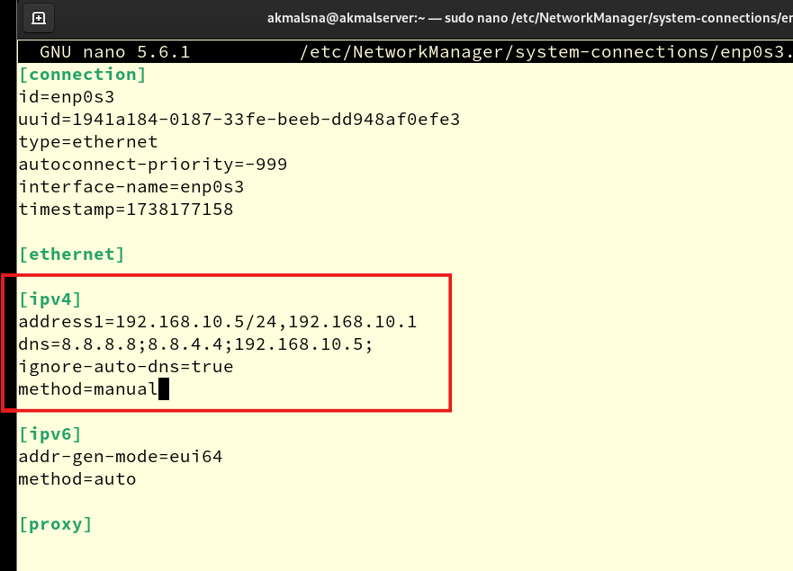

## 2. Network File System (NFS)

A directory was exported from Rocky Linux to the Ubuntu client, enabling shared file access across machines.

```bash
# Rocky Linux: example export entry in /etc/exports
/var/nfs/general 192.168.10.4(rw,sync,no_subtree_check)

# Apply and inspect exports
sudo exportfs -arv
sudo exportfs -s

# Ubuntu: mount the exported directory
sudo mount 192.168.10.5:/var/nfs/general /nfs/Shared_From_Server
```

**Evidence:** The Ubuntu client accessed server-created files, and a file created on Ubuntu became visible on the Rocky Linux server. A persistent mount was subsequently configured.

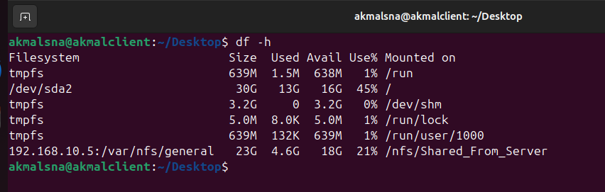
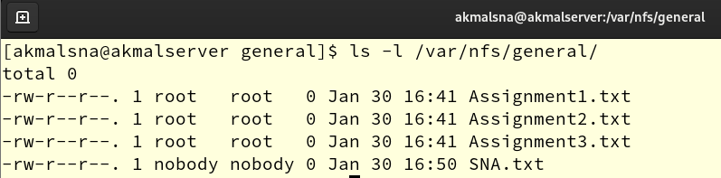

## 3. Apache web server — my documentation focus

I documented the installation, activation, and configuration of Apache HTTP Server to serve two independent websites from the same Rocky Linux host.

```bash
sudo dnf install -y httpd
sudo systemctl start httpd
sudo systemctl enable httpd
sudo mkdir -p /var/www/site1 /var/www/site2
printf '<h1>Site 1</h1>\n' | sudo tee /var/www/site1/index.html
printf '<h1>Site 2</h1>\n' | sudo tee /var/www/site2/index.html
```

The report then defines Apache virtual hosts, adds client-side name resolution, restarts Apache, and verifies both sites in the Ubuntu browser.

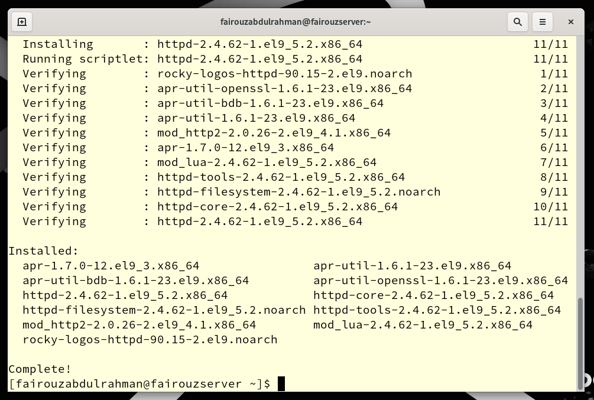
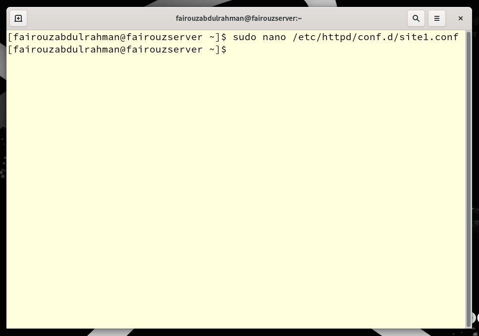
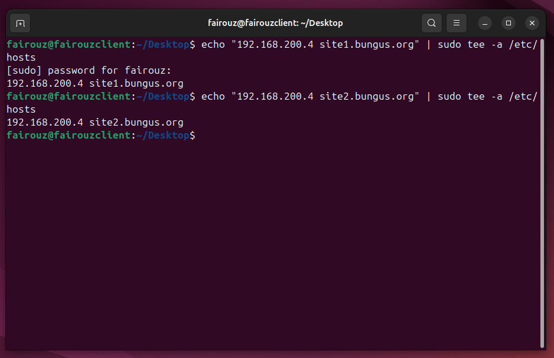
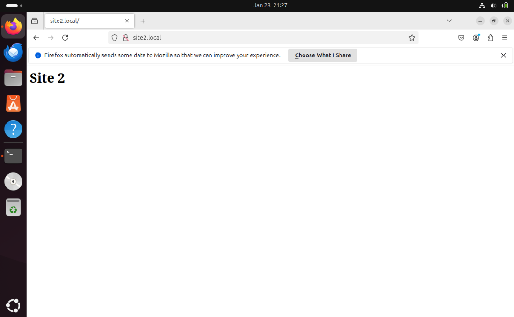

## 4. Certificate Authority / OpenSSL — my documentation focus

I documented the team's use of OpenSSL for certificate and key generation, with the goal of supporting encrypted web communication in the lab. The report demonstrates a **self-signed certificate workflow**; it does not establish a publicly trusted production PKI.

```bash
sudo dnf install openssl
openssl genrsa -out ca.key 2048
sudo openssl req -x509 -newkey rsa:2048 \
  -keyout /etc/pki/tls/private/ca.key \
  -out /etc/pki/tls/certs/ca.crt -days 365 -nodes
```

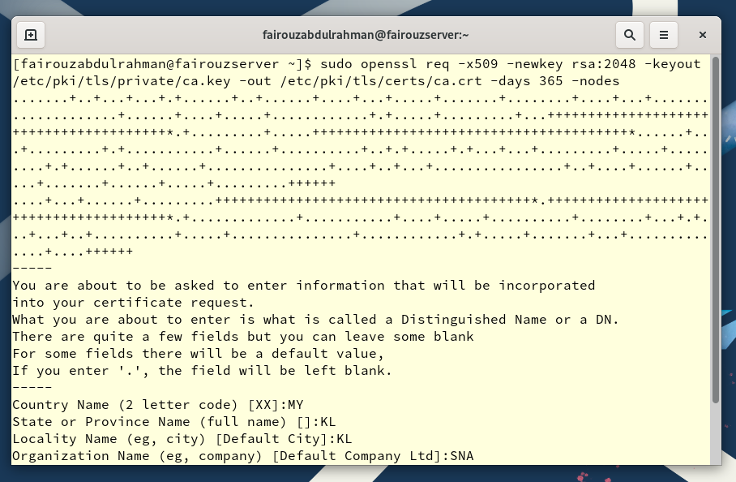
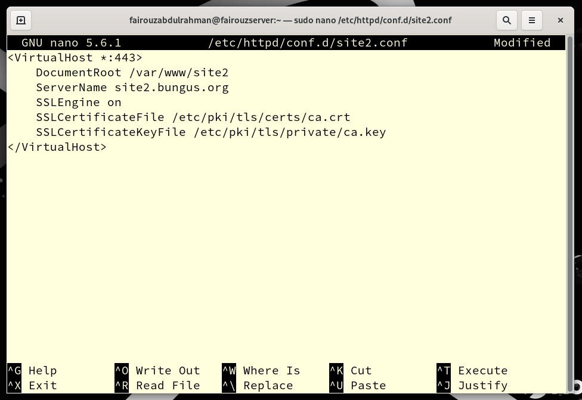

## 5. Intrusion prevention with Fail2Ban

The team used Fail2Ban to monitor repeated SSH authentication failures. The report shows a client being blocked after three unsuccessful login attempts, followed by a server-side status check showing a banned client.

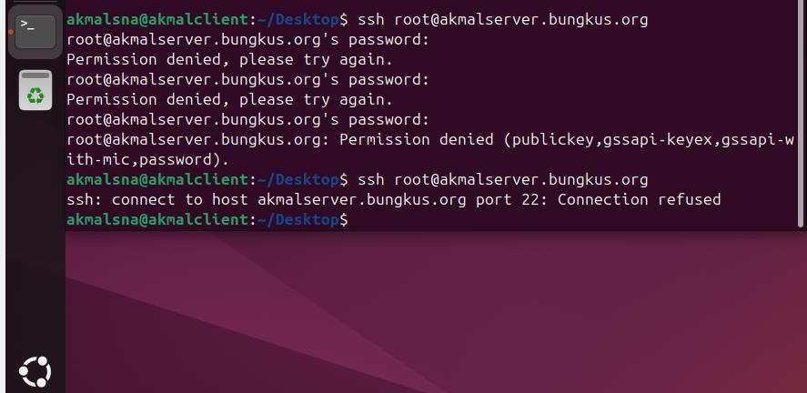
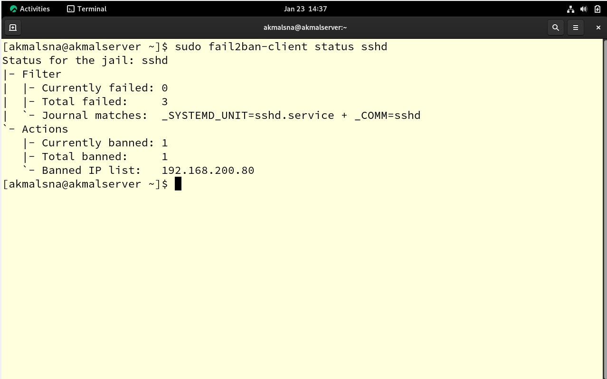

## 6. Centralized logging with rsyslog

The team configured rsyslog and allowed syslog traffic on port 514 (TCP/UDP) in the lab firewall. The report documents remote logging and test messages to validate collection.

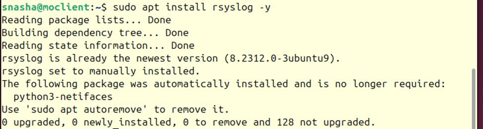
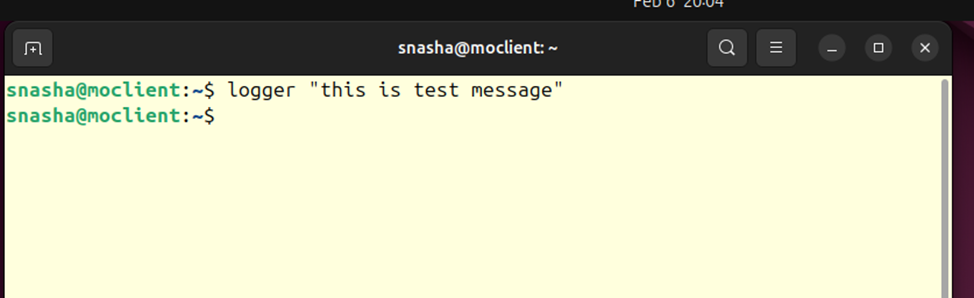

## Results and lessons learned

- Verified server/client connectivity and FQDN-based configuration in a Linux lab.
- Demonstrated two-way NFS file visibility and a persistent client mount.
- Hosted and tested two Apache websites through virtual-host configuration.
- Practiced certificate creation and configuration using OpenSSL.
- Demonstrated SSH login protection using Fail2Ban and centralized syslog collection.
- Reinforced the importance of service status checks, firewall configuration, and client-side validation.

## Scope and security notes

This is an **academic lab**, not a production-ready deployment. The report includes self-signed certificate material and private lab domains. Production use would require stronger key management, certificate trust validation, hardened service policies, least-privilege access, and environment-specific firewall rules. No live server or source repository is supplied here; the included images are evidence extracted from the submitted report.

## Repository contents

- `README.md` — portfolio documentation
- `*.png` — selected screenshots and verification evidence extracted from the original report
- `GROUP_DOCUMENTATION_FINAL.pdf` — complete original team submission and workload matrix

## Attribution

**Contributor highlighted:** Fairouz Abdulrahman Hamed Mousa  
**Team members:** Akmal Nasimboev, Mokhamad Akra, Fairouz Abdulrahman Hamed Mousa, Tasmay Shah, and Lee Pei Syuen.

This README is a portfolio adaptation of the team's submitted assignment. Contributions are attributed according to the workload matrix on pages 72–73 of the original PDF.
